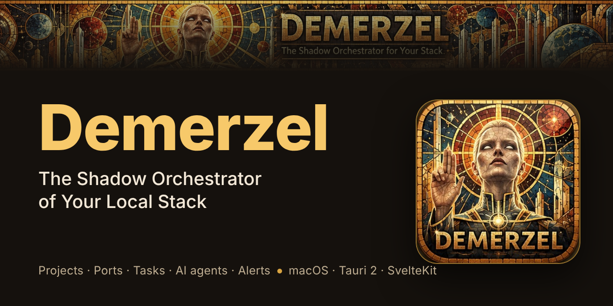
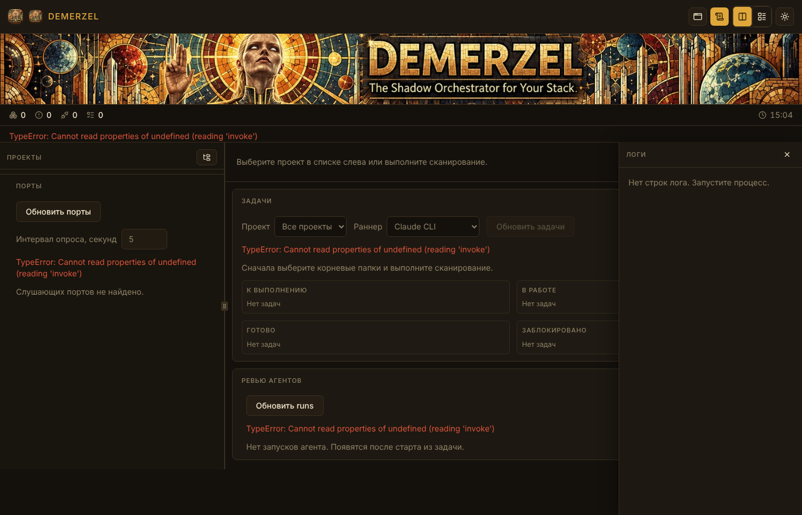

# Demerzel

**The Shadow Orchestrator of Your Local Stack.**



Demerzel ist ein lokaler Orchestrator für Entwickler auf macOS. Er behält Projekte und Unterprojekte auf Ihrem Rechner im Blick, startet und stoppt Dev-Server, verhindert Portkonflikte, wandelt Projektaufgaben in Arbeit für KI-Coding-Agenten um und meldet, wenn etwas abstürzt: über ein Widget in der Menüleiste, eine Benachrichtigung oder gesprochen.

🌐 **Sprachen:** [English](README.md) · [Русский](README.ru.md) · Deutsch



## Funktionen

- **Projekte und Unterprojekte.** Durchsucht die Ordner, die Sie wählen, erkennt Projekte an ihrer `orchestrator.json` und zeigt, was läuft, was beendet wurde und warum.
- **Prozesse.** Dev-Befehle starten, stoppen und neu starten. Prozesse überleben einen Neustart der App: Demerzel verbindet sich über die PID wieder mit ihnen. Logs werden für jeden Prozess gespeichert.
- **Ports.** Zeigt die lauschenden Ports, ordnet sie Projekten zu und markiert Konflikte.
- **Aufgaben.** Liest Aufgaben aus `TODO.md`, `tasks.json`, GitHub Issues oder Notion. Neue Aufgaben werden als GitHub Issue im Repository des Projekts angelegt. Fehler und Warnungen aus dem Prozesslog werden mit einem Klick zu einer Fix-Aufgabe.
- **KI-Agenten.** Lässt einen Agenten eine Aufgabe in einem eigenen git-Worktree bearbeiten, sodass Änderungen den Hauptbranch nie berühren. Verfügbare Runner: Claude Code CLI, Ollama (lokale Modelle) und jeder Agent, der das [Agent Client Protocol](https://zed.dev/acp) spricht. Ein zweiter Agent kann den Diff reviewen. Nach jeder Änderung laufen die Tests.
- **Alarme.** Regeln für Abstürze, Portkonflikte sowie fehlgeschlagene Agenten und Tests. Zustellung über macOS-Benachrichtigungen und gesprochene Sätze, mit Drosselung und Ruhezeiten.
- **Widget und CLI.** Ein Desktop-Widget (macOS) und der Befehl `dem` mit `status`, `up`, `down`, `sync`, `watch`, `pulse` und `restart`.
- **Zusammenfassung für das iPhone.** Schreibt eine `summary.json` in iCloud Drive, damit Sie den Stand Ihres Stacks auf dem Telefon sehen.
- **Updates.** Signierte Releases von GitHub. Prüfung nach dem Start und alle sechs Stunden; installiert wird nur auf Ihren Wunsch.

Demerzel führt die KI-Agenten aus, die Sie installiert und eingerichtet haben. Was diese Agenten senden und wohin, bestimmen die Agenten selbst.

## Voraussetzungen

- macOS (Widget, Benachrichtigungen und `say` sind dafür gebaut)
- [Bun](https://bun.sh/) 1.4 oder neuer
- Rust (stable) und die Xcode Command Line Tools
- Optional: [Claude Code CLI](https://docs.anthropic.com/en/docs/claude-code), [Ollama](https://ollama.com/), ein ACP-kompatibler Agent, Docker Desktop (für `type: docker-compose` in `demerzel.yaml`), [GitHub CLI](https://cli.github.com/) (`gh`) für GitHub-Aufgaben

## Schnellstart

```sh
git clone https://github.com/korzhanov/demerzel.git
cd demerzel
bun install
bun run tauri dev
```

App bauen: `bun run tauri build`.

Tests:

```sh
bun test src/lib            # Frontend
cd src-tauri && cargo test  # Backend
bun run check               # Typen
```

macOS braucht Zugriff auf Ordner in `Documents`, auf dem Schreibtisch und in iCloud. Siehe [docs/permissions.md](docs/permissions.md).

## Projekt konfigurieren

Im Stammverzeichnis **jedes** Projekts und Unterprojekts liegt eine [`orchestrator.json`](docs/orchestrator.schema.json). Die Datei wird beim Laden geprüft.

```json
{
  "name": "api",
  "type": "service",
  "commands": {
    "dev": "bun run dev",
    "test": "bun test",
    "migrate": "bunx prisma migrate deploy"
  },
  "ports": {
    "range": [5100, 5199],
    "default": 5100
  },
  "tasks": {
    "source": "todo"
  },
  "env": {
    "NODE_ENV": "development"
  }
}
```

| Feld | Bedeutung |
|---|---|
| `name` | Projektname (Pflicht) |
| `type` | `app` \| `parser` \| `dashboard` \| `service` |
| `commands.dev` | Entwicklungsbefehl (GUI / `dem up`) |
| `commands.test` | Tests nach einem Agentenlauf |
| `commands.migrate` | Migrationen bei `dem sync` (leer heißt überspringen) |
| `ports.range` | Portbereich `[start, end]` |
| `ports.default` | Standardport innerhalb des Bereichs |
| `tasks.source` | `todo` (`TODO.md`) \| `tasks-json` \| `github` \| `notion` |
| `tasks.repository` | `owner/name` für `source: github` |
| `tasks.database_id` | UUID der Notion-Datenbank für `source: notion` (braucht `NOTION_TOKEN`) |
| `pulse` | Fortschrittsabfrage: `command` **oder** `file` ([docs/pulse.md](docs/pulse.md)) |
| `env` | Umgebungsvariablen für den Prozess |

Bei einem Monorepo oder mehreren Diensten listet eine Wurzel-`demerzel.yaml` sie auf ([docs/demerzel-yaml.md](docs/demerzel-yaml.md)).

App-weite Einstellungen (Alarme, Agentenlimits, Runner, iCloud-Zusammenfassung, Widget) stehen in der `settings.json` der App, nicht in `orchestrator.json`.

## Dokumentation

Das vollständige Verzeichnis steht in [docs/README.md](docs/README.md). Die Referenzdokumente sind vorerst auf Russisch verfasst; diese README gibt es in drei Sprachen.

- [docs/agents.md](docs/agents.md): Worktrees, Claude Code, Ollama, ACP, Review, Auto-Fix
- [docs/alerts.md](docs/alerts.md): Alarmregeln und Zustellung
- [docs/cli.md](docs/cli.md): der Befehl `dem`
- [docs/tasks-format.md](docs/tasks-format.md): Aufgabenquellen
- [docs/icloud-summary.md](docs/icloud-summary.md): Zusammenfassung für das iPhone
- [docs/widget-macos.md](docs/widget-macos.md): Desktop-Widget
- [docs/CONVENTIONS.md](docs/CONVENTIONS.md): Branches, Commits, Versionen
- [CHANGELOG.md](CHANGELOG.md): technisches Changelog

## Status

Demerzel ist ein frühes Open-Source-Projekt für macOS. Die aktuelle Version steht in [`VERSION`](VERSION). Fehler und Ideen sind willkommen als [GitHub Issues](https://github.com/korzhanov/demerzel/issues). Pull Requests ebenfalls: ein Issue, ein Branch, ein PR.

## Mitwirken

Lesen Sie zuerst [docs/CONVENTIONS.md](docs/CONVENTIONS.md): Branch-Namen, Conventional Commits und die Regeln für Versionen und Journale. Die Dokumentation wird im selben PR aktualisiert wie der Code, den sie beschreibt.

## Lizenz

Apache License 2.0. Siehe [LICENSE](LICENSE).
