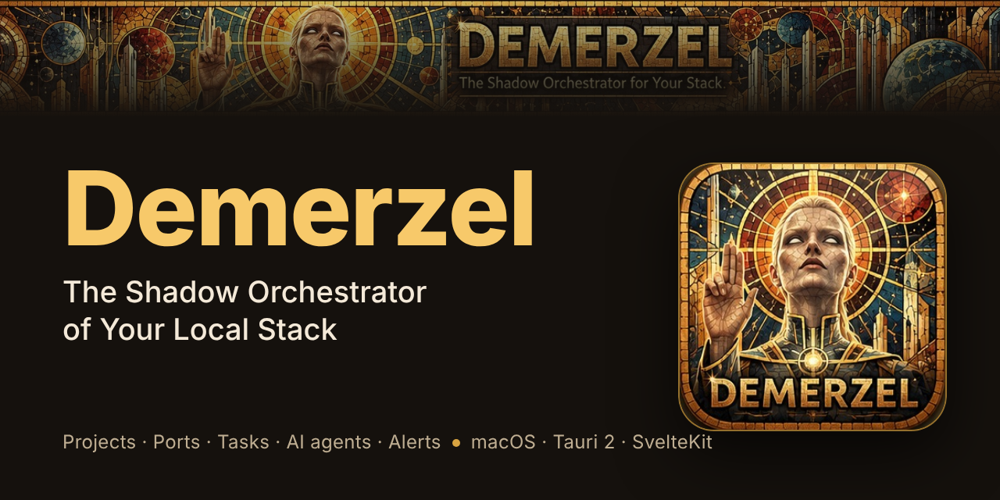
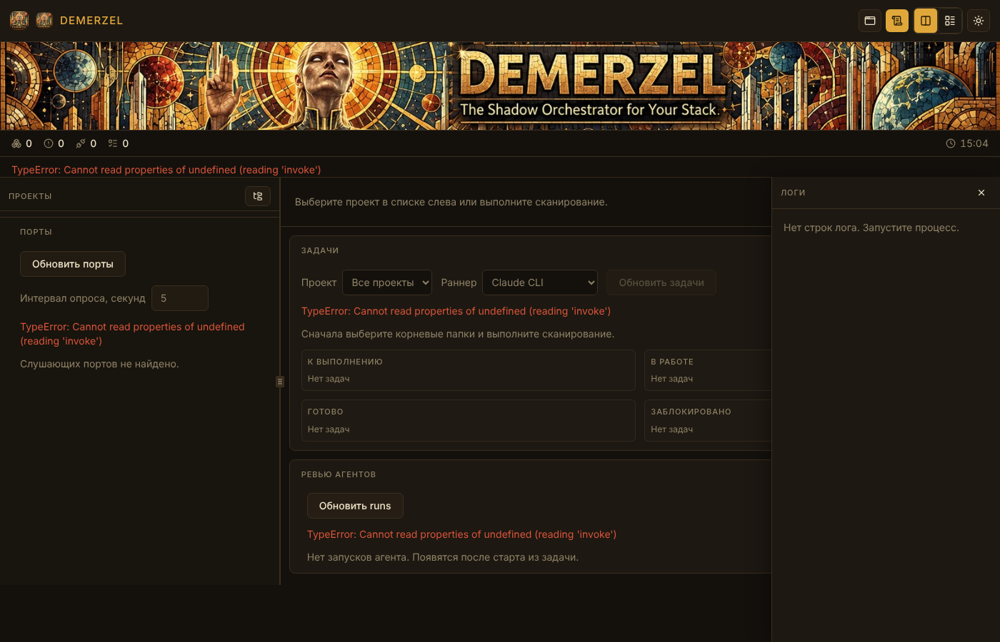

# Demerzel

**The Shadow Orchestrator of Your Local Stack.**



Demerzel is a local orchestrator for macOS developers. It watches the projects and sub-projects on your machine, starts and stops their dev servers, keeps ports from colliding, turns project tasks into work for AI coding agents, and tells you when something breaks: by menu bar widget, desktop notification, or voice.

🌐 **Languages:** English · [Русский](README.ru.md) · [Deutsch](README.de.md)



## What it does

- **Projects and sub-projects.** Scans the folders you choose, detects each project by its `orchestrator.json`, and shows what is running, what has exited, and why.
- **Processes.** Start, stop, and restart dev commands. Demerzel keeps running processes alive across app restarts and re-attaches to them by PID. Logs are kept for each process.
- **Ports.** Lists listening ports, maps them to projects, and flags conflicts.
- **Tasks.** Reads tasks from `TODO.md`, `tasks.json`, GitHub Issues, or Notion. New tasks are created as GitHub issues in the project's repository. Errors and warnings from a process log can become a fix task in one click.
- **AI agents.** Runs an agent on a task in its own git worktree, so changes never touch your main branch. Supported runners: Claude Code CLI, Ollama (local models), and any agent that speaks the [Agent Client Protocol](https://zed.dev/acp). A second agent can review the diff. Tests run after each change.
- **Alerts.** Rules for crashes, port conflicts, failed agents, and failed tests. Delivery through macOS notifications and spoken phrases, with throttling and quiet hours.
- **Widget and CLI.** A desktop widget (macOS) and a `dem` command for `status`, `up`, `down`, `sync`, `watch`, `pulse`, and `restart`.
- **iPhone summary.** Writes a `summary.json` to iCloud Drive, so you can read the state of your stack on your phone.
- **Updates.** Signed releases from GitHub, checked after launch and every six hours. You decide when to install.

Demerzel runs the AI agents you install and configure. What they send, and where, is up to those agents.

## Requirements

- macOS (the widget, notifications, and `say` are built for it)
- [Bun](https://bun.sh/) 1.4 or newer
- Rust (stable) and Xcode Command Line Tools
- Optional: [Claude Code CLI](https://docs.anthropic.com/en/docs/claude-code), [Ollama](https://ollama.com/), an ACP-compatible agent, Docker Desktop (for `type: docker-compose` in `demerzel.yaml`), [GitHub CLI](https://cli.github.com/) (`gh`) for GitHub tasks

## Quick start

```sh
git clone https://github.com/korzhanov/demerzel.git
cd demerzel
bun install
bun run tauri dev
```

To build the app: `bun run tauri build`.

Run the tests:

```sh
bun test src/lib            # frontend
cd src-tauri && cargo test  # backend
bun run check               # types
```

macOS needs access to folders in `Documents`, Desktop, and iCloud. See [docs/permissions.md](docs/permissions.md).

## Configure a project

Each project and sub-project has an [`orchestrator.json`](docs/orchestrator.schema.json) in its root. It is validated on load.

```json
{
  "name": "api",
  "type": "service",
  "commands": {
    "dev": "bun run dev",
    "test": "bun test",
    "migrate": "bunx prisma migrate deploy"
  },
  "ports": {
    "range": [5100, 5199],
    "default": 5100
  },
  "tasks": {
    "source": "todo"
  },
  "env": {
    "NODE_ENV": "development"
  }
}
```

| Field | Purpose |
|---|---|
| `name` | Project name (required) |
| `type` | `app` \| `parser` \| `dashboard` \| `service` |
| `commands.dev` | Dev command (GUI / `dem up`) |
| `commands.test` | Tests after an agent run |
| `commands.migrate` | Migrations on `dem sync` (empty means skip) |
| `ports.range` | Port range `[start, end]` |
| `ports.default` | Default port inside the range |
| `tasks.source` | `todo` (`TODO.md`) \| `tasks-json` \| `github` \| `notion` |
| `tasks.repository` | `owner/name` for `source: github` |
| `tasks.database_id` | Notion database UUID for `source: notion` (needs `NOTION_TOKEN`) |
| `pulse` | Progress polling: `command` **or** `file` ([docs/pulse.md](docs/pulse.md)) |
| `env` | Environment variables for the process |

For a monorepo or several services, a root [`demerzel.yaml`](docs/demerzel-yaml.md) lists them.

App-wide settings (alerts, agent limits, runners, iCloud summary, widget) live in the app's `settings.json`, not in `orchestrator.json`.

## Documentation

The full index is in [docs/README.md](docs/README.md). The reference documents are written in Russian for now; this README is available in three languages.

- [docs/agents.md](docs/agents.md): worktrees, Claude Code, Ollama, ACP, review, auto-fix
- [docs/alerts.md](docs/alerts.md): alert rules and delivery
- [docs/cli.md](docs/cli.md): the `dem` command
- [docs/tasks-format.md](docs/tasks-format.md): task sources
- [docs/icloud-summary.md](docs/icloud-summary.md): the iPhone summary
- [docs/widget-macos.md](docs/widget-macos.md): the desktop widget
- [docs/CONVENTIONS.md](docs/CONVENTIONS.md): branches, commits, versions
- [CHANGELOG.md](CHANGELOG.md): technical changelog

## Status

Demerzel is an early open-source project for macOS. The current version is in [`VERSION`](VERSION). Bugs and ideas are welcome as [GitHub Issues](https://github.com/korzhanov/demerzel/issues). Pull requests are welcome too: one issue, one branch, one PR.

## Contributing

Read [docs/CONVENTIONS.md](docs/CONVENTIONS.md) first: it covers branch names, Conventional Commits, and how versions and journals are updated. Keep the docs in the same PR as the code they describe.

## License

Apache License 2.0. See [LICENSE](LICENSE).
