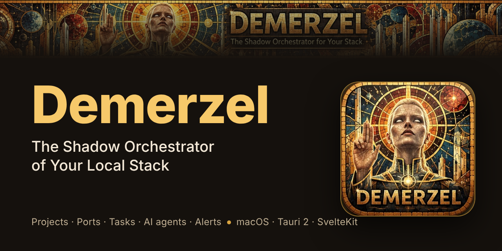
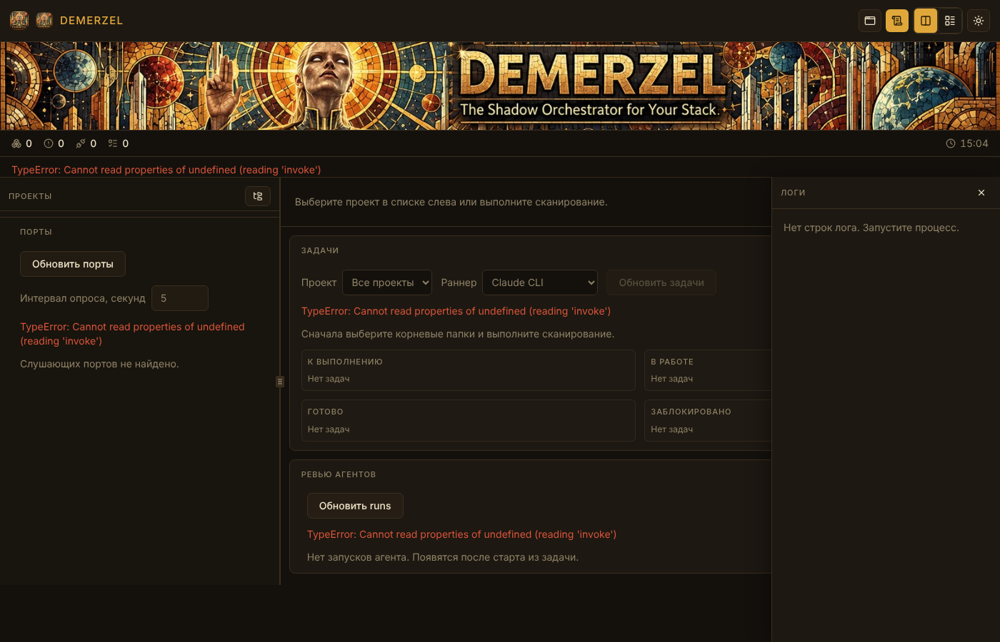

# Demerzel

**The Shadow Orchestrator of Your Local Stack.**



Demerzel — локальный оркестратор для разработчиков на macOS. Он следит за проектами и подпроектами на вашей машине, запускает и останавливает dev-серверы, не даёт портам конфликтовать, превращает задачи проекта в работу для ИИ-агентов и сообщает, когда что-то упало: через виджет в строке меню, уведомление или голосом.

🌐 **Языки:** [English](README.md) · Русский · [Deutsch](README.de.md)



## Что умеет

- **Проекты и подпроекты.** Сканирует выбранные папки, находит проекты по `orchestrator.json` и показывает, что запущено, что упало и почему.
- **Процессы.** Запуск, остановка и перезапуск dev-команд. Процессы переживают перезапуск приложения: Demerzel снова присоединяется к ним по PID. Логи сохраняются для каждого процесса.
- **Порты.** Показывает слушающие порты, сопоставляет их с проектами и отмечает конфликты.
- **Задачи.** Читает задачи из `TODO.md`, `tasks.json`, GitHub Issues или Notion. Новая задача создаётся как issue в репозитории проекта. Ошибки и предупреждения из лога процесса превращаются в fix-задачу одним нажатием.
- **ИИ-агенты.** Запускает агента над задачей в собственном git worktree, поэтому правки не попадают в основную ветку. Раннеры: Claude Code CLI, Ollama (локальные модели) и любой агент, который говорит по [Agent Client Protocol](https://zed.dev/acp). Второй агент может сделать ревью диффа. После каждой правки запускаются тесты.
- **Алерты.** Правила для падений, конфликтов портов, сбоев агентов и тестов. Доставка через уведомления macOS и голосовые фразы, с троттлингом и тихими часами.
- **Виджет и CLI.** Виджет на рабочем столе (macOS) и команда `dem`: `status`, `up`, `down`, `sync`, `watch`, `pulse`, `restart`.
- **Сводка для iPhone.** Записывает `summary.json` в iCloud Drive, чтобы состояние стека было видно с телефона.
- **Обновления.** Подписанные релизы с GitHub. Проверка после запуска и каждые шесть часов; установку вы запускаете сами.

Demerzel запускает ИИ-агентов, которые вы установили и настроили. Что и куда они отправляют, решают сами агенты.

## Требования

- macOS (виджет, уведомления и `say` сделаны под неё)
- [Bun](https://bun.sh/) 1.4 или новее
- Rust (stable) и Xcode Command Line Tools
- Необязательно: [Claude Code CLI](https://docs.anthropic.com/en/docs/claude-code), [Ollama](https://ollama.com/), ACP-совместимый агент, Docker Desktop (для `type: docker-compose` в `demerzel.yaml`), [GitHub CLI](https://cli.github.com/) (`gh`) для задач GitHub

## Быстрый старт

```sh
git clone https://github.com/korzhanov/demerzel.git
cd demerzel
bun install
bun run tauri dev
```

Сборка приложения: `bun run tauri build`.

Тесты:

```sh
bun test src/lib            # фронтенд
cd src-tauri && cargo test  # бэкенд
bun run check               # типы
```

macOS нужно разрешить доступ к папкам в `Documents`, на Рабочем столе и в iCloud: см. [docs/permissions.md](docs/permissions.md).

## Настройка проекта

В корне **каждого** проекта и подпроекта лежит [`orchestrator.json`](docs/orchestrator.schema.json). Файл проверяется при загрузке.

```json
{
  "name": "api",
  "type": "service",
  "commands": {
    "dev": "bun run dev",
    "test": "bun test",
    "migrate": "bunx prisma migrate deploy"
  },
  "ports": {
    "range": [5100, 5199],
    "default": 5100
  },
  "tasks": {
    "source": "todo"
  },
  "env": {
    "NODE_ENV": "development"
  }
}
```

| Поле | Назначение |
|---|---|
| `name` | Имя проекта (обязательно) |
| `type` | `app` \| `parser` \| `dashboard` \| `service` |
| `commands.dev` | Команда разработки (GUI / `dem up`) |
| `commands.test` | Тесты после прогона агента |
| `commands.migrate` | Миграции при `dem sync` (пусто — пропуск) |
| `ports.range` | Диапазон портов `[start, end]` |
| `ports.default` | Порт по умолчанию внутри диапазона |
| `tasks.source` | `todo` (`TODO.md`) \| `tasks-json` \| `github` \| `notion` |
| `tasks.repository` | `owner/name` для `source: github` |
| `tasks.database_id` | UUID базы Notion для `source: notion` (нужен `NOTION_TOKEN`) |
| `pulse` | Опрос прогресса: `command` **или** `file` ([docs/pulse.md](docs/pulse.md)) |
| `env` | Переменные окружения процесса |

Для монорепо или нескольких сервисов корневой [`demerzel.yaml`](docs/demerzel-yaml.md) перечисляет их.

Настройки приложения (алерты, лимиты агентов, раннеры, сводка iCloud, виджет) лежат в `settings.json` приложения, а не в `orchestrator.json`.

## Документация

Полный указатель: [docs/README.md](docs/README.md). Справочные документы пока написаны по-русски.

- [docs/agents.md](docs/agents.md): worktree, Claude Code, Ollama, ACP, ревью, автофикс
- [docs/alerts.md](docs/alerts.md): правила алертов и доставка
- [docs/cli.md](docs/cli.md): команда `dem`
- [docs/tasks-format.md](docs/tasks-format.md): источники задач
- [docs/icloud-summary.md](docs/icloud-summary.md): сводка для iPhone
- [docs/widget-macos.md](docs/widget-macos.md): виджет на рабочем столе
- [docs/CONVENTIONS.md](docs/CONVENTIONS.md): ветки, коммиты, версии
- [CHANGELOG.md](CHANGELOG.md): технический журнал

## Статус

Demerzel — ранний open-source проект для macOS. Текущая версия — в [`VERSION`](VERSION). Ошибки и идеи — в [GitHub Issues](https://github.com/korzhanov/demerzel/issues). Pull request'ы тоже приветствуются: одна задача — одна ветка — один PR.

## Участие

Сначала прочитайте [docs/CONVENTIONS.md](docs/CONVENTIONS.md): там ветки, Conventional Commits и правила обновления версий и журналов. Документация правится в том же PR, что и код, который она описывает.

## Лицензия

Apache License 2.0. См. [LICENSE](LICENSE).
